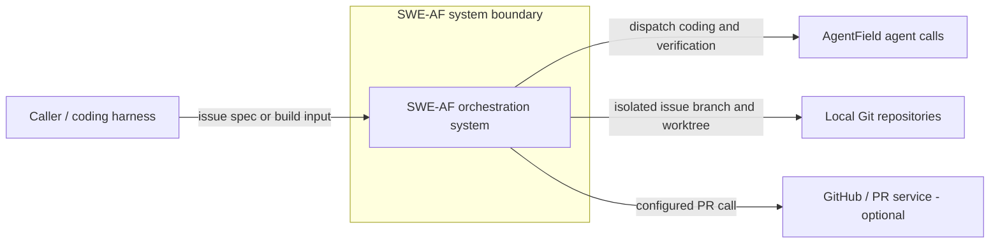

# SWE-AF C4 context — source-bound R14

Date: 2026-10-14. Status: **UNACCEPTED / source-contract candidate**.

## Scope and source of truth

FACT: Target root is `D:/Users/NIKITA/Documents/DEV/universal-solver-site/swe-af`, not BMAD-MNNZ. The coordinator supplied Git receipt `064a7226a500365005b5b662044fc9014a328722`; no independent branch/dirty-state inspection is available through this scoped adapter. Exact byte fingerprints, public signatures, input tags, constructor fields, and diagram evidence are in `basefive-r14-contracts.json`.

FACT: `docs/acceptance/c4-releasegate-reducer-frontier-20261013.md` remains the acceptance source of truth. It records an unmet native ReleaseGate runtime gate. This candidate adds architecture evidence; it neither replaces that gate nor updates coordinator state.

## Level 1 — system context

The diagram uses Mermaid flowchart notation for a C4 context view. It is a logical view of observed source interactions, not a deployment or live-service receipt.

## Reading the three levels

- Level 1: this system context identifies the caller, agent dispatch, local Git, and optional PR boundary.
- Level 2: `basefive-r14-container.mmd` separates the Python issue orchestrator and Go full-build orchestrator. Their code modules are logical runtime containers; process topology is UNVERIFIED. No Python-to-Go call or parity relationship is asserted.
- Level 3: `basefive-r14-component.mmd` expands both orchestrators into inspected functions, imported dependencies, and result constructors. Imported component implementations remain outside this task's read scope.

FACT: Python exposes `implement_issue(issue: dict, repo_path: str, base_branch: str = "", artifacts_dir: str = ".artifacts", additional_context: str = "", config: dict | None = None) -> dict`. Go exposes `Build(ctx context.Context, deps *Deps, input map[string]any) (any, error)` and registers it under `build` in this file's `Handlers()` map. These are different APIs: issue execution without planning versus goal-driven full-build orchestration.

FACT: Python validates `IssueSpec` at the call site and serializes `IssueBuildResult`. Go binds ten `buildInput` JSON tags and populates seven `schemas.BuildResult` constructor fields, with conditional `workspace_handle`. DTO definitions and wire schema versions are not inspectable here; compatibility is **UNVERIFIED**, not inferred from shared field names or tool schema version `1.0.0`.

## Verification boundary

Run `node --test docs/architecture/basefive-r14-contract.test.mjs` through the authorized runner. Checks bind source SHA-256, extracted API/DTO observations, graph coverage, and every declared Mermaid node/edge to source anchors. Mutation tests reject source drift, altered signatures/tags/fields, fabricated edges, optimistic coverage, and unsupported acceptance claims.

The test validates a deliberately restricted Mermaid flowchart grammar and its source mapping; it does not invoke a Mermaid renderer, execute Python/Go, validate imported DTO definitions, or prove restart safety. See `basefive-r14-drift-analysis.md` for the proposed ADR, coverage boundaries, and recovery requirements. Independent reviewer/reducer acceptance remains required.
